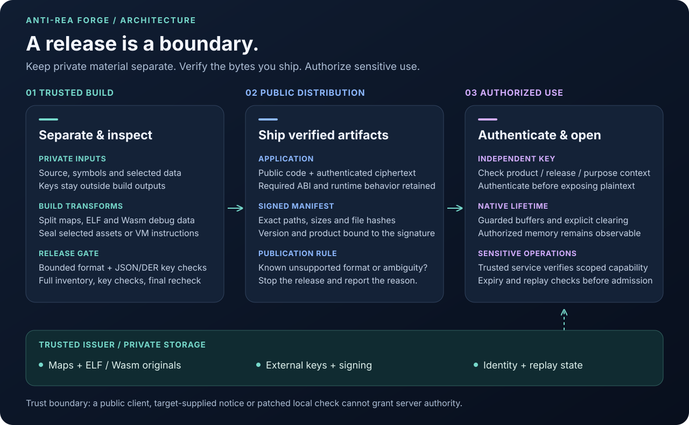

# Anti-REA Forge 1.1

[](https://github.com/Afloat16/anti-rea-forge/actions/workflows/ci.yml)
[](https://github.com/Afloat16/anti-rea-forge/releases/latest)
[](LICENSE)

[English](README.md) · [简体中文](README.zh-CN.md) · [Download v1.1.0](https://github.com/Afloat16/anti-rea-forge/releases/tag/v1.1.0) · [Upgrade guide](docs/releases/v1.1.0.md)

**Reduce what reverse-engineering tools can recover from a release. Keep private material outside it.**

Anti-REA Forge combines bounded release inspection, private debug/source-map separation, authenticated native data and trusted service authorization. It gives Python, CMake/C++ and JavaScript builds one set of release decisions, backed by reproducible positive and negative controls.

| REA 6.9.0 / WebAssembly | Recoverable key disclosures | Release gate |
| --- | --- | --- |
| **3 → 0 → 3 private identifiers recovered** | **5 / 5 detected; v1.0 missed all 5** | **3 operating systems · 13 required CI jobs** |
| Original → public → restored private original; 9 runtime inputs unchanged | Escaped JSON, byte arrays, JWK and DER; actual decryption/signing positive controls | Fresh wheel, source and SDK installations; zero npm runtime dependencies |

These are measured results for owned fixtures, not a general cracking-resistance rate. REA/WABT still reconstructs readable Wasm instructions in every group. The key control uses standard JSON/cryptography readers and rejects disclosure before publication. [Wasm npm evidence](docs/results/wasm-recovery-v1.1.0-rea-6.9.0.json) · [Pinned-source evidence](docs/results/wasm-recovery-v1.1.0-rea-source.json) · [Key evidence](docs/results/structured-secret-recovery-v1.1.0.json) · [Release gate policy](release-policy.json)



## What is new in 1.1

- **Close a demonstrated REA Wasm entry point.** Default inspection now recognizes private `name`, DWARF and debug-URL custom sections, including renamed modules and modules inside inspected ZIP/ASAR archives. `split-wasm-debug` removes supported debug sections, retains every other byte, verifies both outputs, and stores the complete original privately. [Wasm integration](docs/private-wasm-debug.md)
- **Inspect recoverable keys after decoding.** Bounded JSON checks cover escaped strings, root strings, configured 32-byte arrays and supported private JWK material. Standalone unencrypted DER private keys receive a separate bounded check. Public keys stay usable; unsupported or over-budget recognized inputs fail explicitly.
- **Run three-sided recovery controls.** Published REA 6.9.0 and a clean build of pinned source `c338e54c…`, using official WABT 1.0.42, examine original, public and private-restored modules; the real source-map control now also restores the private map and recovers the original again. Errors, partial analysis and missing tools never count as protection.
- **Verify the installed feature, too.** Every wheel/source installation must exercise Wasm separation and structured-key rejection before release. Existing ELF/PE/Mach-O checks, external-key native assets, isolated CMake/JavaScript integration and trusted capability authorization remain in the same required CI gate.

[Audit, compatibility and evidence](docs/releases/v1.1.0.md) · [Portable release integration](docs/portable-release.md) · [Security boundaries](SECURITY.md)

## Evidence with controls

| Question | Measured result | Exact scope / record |
| --- | --- | --- |
| Can REA recover the Wasm private names after separation? | **3 → 0 → 3**; module size **255 → 134 bytes**, executable sections identical | One owned module, REA 6.9.0 / WABT 1.0.42; [complete evidence](docs/results/wasm-recovery-v1.1.0-rea-6.9.0.json). Equivalent logic remains readable. |
| Does withholding the source map remove the exact original-source channel? | **1 → 0 → 1** exact original recovered; generated JS unchanged | Original/public/private-restored, real REA and trace-mapping; [evidence](docs/results/source-map-recovery-v1.1.0-rea-6.9.0.json) |
| Do encoded keys actually work after recovery? | **5 / 5** decrypt or sign successfully; v1.1 blocks all 5, while **2 / 2** nonsecret controls pass | Verified public v1.0.0 wheel comparison; [evidence](docs/results/structured-secret-recovery-v1.1.0.json) |
| Can an analyzer recover an embedded plaintext resource? | **Yes**, with both tools | Positive control in the [paired Ghidra/IDA observation](docs/results/native-asset-controls.json) |
| Can the same procedure recover the encrypted resource without its external key? | **0 exact payload recoveries**; all 18,024 Ghidra and 18,121 IDA contiguous 32-byte candidates tested | Same owned i386 fixture; initialized analyzer bytes checked against input |
| Does accidentally shipping the real key defeat that boundary? | **Yes**: key recovered, replayed, exact resource read | Both analyzers; the production release gate also reports the leaked key |
| Does patching the local gate supply the missing encryption key? | Plaintext control recovers; encrypted control does not recover exact data | Actual gate patch and forced-GCM-success controls, [method](docs/native-assets.md) |
| What does opening a 1 MiB native asset cost? | **189.860 µs median**, 25 calls after 5 warmups; maximum 1,456.005 µs | Historical v0.10 run on one Linux x86-64 host; includes allocation/cleansing, excludes key delivery/startup. [All samples](docs/results/native-asset-cost.json) |
| What is validated for the downloadable release? | Exact commit, required CI job results, installed-package checks and archive hashes | `release-evidence.json`, `installation-report.json` and `SHA256SUMS` attached to the [Release](https://github.com/Afloat16/anti-rea-forge/releases/tag/v1.1.0) |

Ghidra, compiler, REA CLI/source-map, official ASAR, GNU binutils, macOS and MSVC controls run in CI. Historical observations stay dated and retain their failures. Ordinary and VM-only native samples were independently reconstructed across **1,081,924 hidden evaluations**; that failure motivated external-key instruction sealing. [Native code research and remaining validation](docs/native-code.md)

## Start with the release gate

Python 3.10+ is required. Install the wheel from [v1.1.0](https://github.com/Afloat16/anti-rea-forge/releases/tag/v1.1.0) into your chosen virtual environment, or run `python -m pip install .` from this checkout. The public command and import name remain `releaseguard`.

```sh
python -m pip install https://github.com/Afloat16/anti-rea-forge/releases/download/v1.1.0/open_release_guard-1.1.0-py3-none-any.whl
python -m releaseguard --version
python -m releaseguard project-init --root dist --product MyApp --out .releaseguard
python -m releaseguard check --config .releaseguard/project.json
```

Build your application into `dist`, review `.releaseguard/policy.json`, and keep private symbols, keys and signing material outside that directory. Add known external keys to `asset_key_files` in the saved project configuration. A failed check returns a nonzero exit code. `prepare` scans and signs an immutable staging directory and writes its evidence outside the release. [Complete workflow](docs/portable-release.md)

### JavaScript / TypeScript

```sh
npm install https://github.com/Afloat16/anti-rea-forge/releases/download/v1.1.0/anti-rea-forge-releaseguard-1.1.0.tgz
```

```js
import { createReleaseGuard } from "@anti-rea-forge/releaseguard";
const guard = createReleaseGuard({ python: process.env.RELEASEGUARD_PYTHON });
const report = await guard.checkProject({ config: ".releaseguard/project.json" });
process.exitCode = report.exitCode;
```

Set `RELEASEGUARD_PYTHON` to the absolute path of the installed virtual-environment interpreter. The SDK archive is distributed through GitHub Releases; no npm registry publication is implied. [SDK guide](packages/releaseguard/README.md)

## Choose the boundary you need

| Need | Integration | Status |
| --- | --- | --- |
| Detect accidental release disclosure and packaging ambiguity | [Portable release gate](docs/portable-release.md) | Cross-platform, policy-driven checks |
| Keep selected native data confidential without its external key | [Native assets](docs/native-assets.md) | C++17/OpenSSL; authenticated context binding |
| Keep private source maps and debug/type information off the client | [Source maps](docs/private-source-maps.md), [ELF symbols](docs/private-elf-debug.md), [Wasm](docs/private-wasm-debug.md) | Public/private split with controlled inputs |
| Enforce a sensitive operation in trusted code | [Service capabilities](docs/runtime-protection.md), [analysis gateway](docs/analysis-authorization.md) | Authenticated identity, fixed policy and replay storage required |
| Encrypt selected VM instruction storage | [Native code](docs/native-code.md) | **Experimental** LLVM 18 / Linux x86-64 scalar-integer subset |

## Trust and limits

A release scan checks configured rules on inspected bytes. It does not disable Ghidra, IDA, REA, Frida or another independent reader. Authorized process memory can hold keys and plaintext; distributed code and public helpers remain observable; a modified local client cannot be the authority for a server operation. Keep staging directories, interpreters, policies, keys and replay storage trusted. Unknown encodings and unsupported formats are not silently promoted to a resistance guarantee.

The 1.x series keeps existing v1 signed-document formats and the CLI/import names. It is not an independent security audit, and experimental native transformations are explicitly scoped. [Security policy](SECURITY.md) · [Upgrade notes](docs/releases/v1.1.0.md) · [Historical recovery failures](docs/testing-2026-10-15.zh-CN.md)

## Reproduce and contribute

```sh
python -m pip install -e .
python -m unittest discover -s tests -v
npm test --prefix packages/releaseguard
# Set RELEASEGUARD_PYTHON to your installed interpreter before real CLI integration:
npm run test:integration --prefix packages/releaseguard
```

The CI workflow pins external compiler/analyzer inputs and marks required controls as mandatory. Missing local tools are reported as skips, not successes. Contributions with a small owned fixture and a reproducible failure are welcome. [Contributing](CONTRIBUTING.en.md) · [MIT license](LICENSE)
