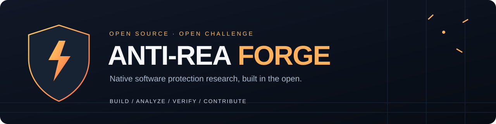

# 🛡️ Anti-REA Forge · 反逆向共建计划

[English](README.md) · [简体中文](README.zh-CN.md)



> **逆向有 AI，防护也要进化。**

面向 **REA 等 AI 辅助逆向工具**的开源软件保护实验工程。我们想把“防反编译、防破解”从一句宣传语，变成有样本、有复现、有失败记录的工程挑战。**欢迎开发者与逆向研究者一起造防护、做分析、公开证据，再一起改进。**

**MIT · 0.4.0 / Alpha · C/C++ 构建接入 · Python 工具链 · PE / ELF**

[加入共建](CONTRIBUTING.md) · [共建招募 Issue](https://github.com/Afloat16/anti-rea-forge/issues/1) · [公开挑战与路线图](docs/ROADMAP.zh-CN.md) · [实际测试报告](docs/testing-2026-10-15.zh-CN.md) · [安全模型](SECURITY.md)

底层工具沿用 **Open Release Guard** 的 Python 包名 `open-release-guard`、CLI `releaseguard` 和 CMake 接口，避免品牌调整影响现有代码。目标面向 Windows EXE/DLL；Linux 与 Windows/MSVC 的构建验证结果见 [GitHub CI](https://github.com/Afloat16/anti-rea-forge/actions)，真实业务与 Windows DLL ABI 仍需单独验证。本项目独立开发，与 REA 官方无隶属或背书关系。

## v0.4：减少动态暴露，把请求授权放到可信服务端

- **原生敏感缓冲区：** C++17 `releaseguard::secure_buffer` 独占带守卫页的不可执行内存，检查锁页结果，在释放前清理自身分配并报告实际保护状态。Linux 可排除这些页的 core dump；本版 Windows 如实报告不提供 dump 排除。使用期间的进程内 hook 仍能观察明文。
- **绑定请求的服务端能力凭证：** 使用独立签名域的 Ed25519，绑定已认证主体、audience、产品、操作与实际请求字节，有效期最多 300 秒。持久 SQLite 状态原子消费一次性标识，并拒绝可信时钟回拨。签发私钥、验证、重放状态与受限操作必须放在可信服务端。
- **针对 REA 的威胁映射：** 固定核查 REA 6.7.0 源码及 Frida 脚本桥接，分别处理内存快照、实时 hook、本地分支替换和凭证重放；参考正式发表于 2024–2026 安全顶会的研究和成熟开源内存方案，区分借鉴原则与已经实现的功能。

见[中文运行时接入](docs/runtime-protection.zh-CN.md)、[English](docs/runtime-protection.md)与[v0.4 验证记录](docs/testing-v0.4-2026-10-20.md)。这些组件需要业务接入；Python 密码学 API 仍返回托管 `bytes`，本版不自动部署服务端、TLS、身份认证或 TEE。授权只消费一次不等于业务恰好执行一次；被窃取的有效 bearer 凭证仍可能被抢先用于其原请求。

## v0.3：移除可逆参考口令，检查整个发布目录

根据用户提供的 REA 实测文章，本轮实现三项强化：

- **单向口令校验：** `password-create / password-check` 使用固定 64 MiB、3 次迭代、4 lanes 的 Argon2id，随机盐、32 字节校验值，在调用 KDF 前拒绝恶意成本参数。不再把可解密的参考口令存入校验记录；弱口令仍能被猜中，本地校验分支仍可被补丁绕过。
- **外部密钥资产：** `asset-keygen / asset-seal / asset-open` 使用随机外部 256 位主密钥、每包 HKDF-SHA256 派生和 AES-256-GCM；绑定调用方可信的产品、版本、用途、资产身份。错误密钥、篡改或跨上下文替换均在创建明文输出前失败。密钥不能随客户端发布；合法解密后的明文和密钥仍可能被内存观察。
- **完整发布目录门禁：** `gate --root` 可按精确文件清单拒绝多余或缺失文件，拦截源码/备份路径、已知旧制品 SHA-256，并在字节预算内检查全部发布文件的声明文字。[严格原生发布策略](examples/policy-strict-release.json) 需要按自己的应用调整，不是通用秘密扫描器。

本版提供 Python API、CLI 和构建工具，尚未提供原生 C/C++ 校验/解密 SDK、代码虚拟化、服务端或密钥服务。离线客户端中的永久秘密无法对控制运行环境的人保证保密；真正要求保密的逻辑应由可信服务端执行并授权，只暴露必要操作。

见[中文接入与文章威胁映射](docs/crypto-protection.zh-CN.md)、[English](docs/crypto-protection.md)、[v0.3 验证记录](docs/testing-2026-10-20.md)及[密码学边界实测](docs/results/crypto-boundary-2026-10-20.json)。实测保留了弱口令被恢复和合法明文在内存可见的对照；它不代表已完成 REA 对抗测评，也不是防破解成功率。

## 先看真实战况

| 已经做了什么 | 当前结果 |
| --- | --- |
| v0.4 本地功能与原生集成测试 | 2026-10-20，331 项中 330 项通过、1 项因 `/proc/self/smaps` 不可用跳过；[详细范围与 Frida 受阻记录](docs/testing-v0.4-2026-10-20.md) |
| 本地功能与真实 CMake 集成测试 | 2026-10-15，176 项通过，无跳过，含 Windows 时间信息兼容与 PE 条目分类回归 |
| 选中文字静态掩码、发布门禁、签名清单与离线授权工具 | 已实现，边界见下文 |
| 独立 Ghidra 静态分析、独立运行时观察 | 均恢复了自有样本的测试口令，原程序接受恢复值；当前防破解目标未达到 |
| REA 6.5.0 整合分析 | 被宿主环境限制阻塞，未完成，不能记作防护成功 |

**这是一份公开挑战的起点。** 如果你能用更少的步骤恢复样本、带来可复现的改进，或者把 Windows 测试补齐，你就是我们想找的共建者。失败记录和复现脚本已经随源码公开，我们欢迎有证据的质疑。

## 一起把它做强

- **会逆向：** 分析仓库自有或获授权样本，提交步骤、工具版本和可验证结果；让下一次改进有明确目标。
- **会 C/C++：** 改进编译接入、兼容性与防护方案，同时证明业务输出和公共接口仍然正确。
- **会 Python 或测试：** 完善 PE/ELF 检查、环境诊断和可复现实验，明确区分恢复成功、超时与环境故障。
- **用 Windows：** 帮我们实际验证 MSVC、EXE/DLL 和调用方兼容性。
- **第一次贡献：** 从文档、最小复现、错误信息和测试环境说明开始。先读 [贡献指南](CONTRIBUTING.md)，小 PR 同样欢迎。

你可以通过仓库的 **Issues → New issue** 选择缺陷、实验报告或方案提议模板，也可以直接提交 PR。请在公开材料中使用合成测试数据；敏感安全问题按 [SECURITY.md](SECURITY.md) 处理。欢迎 Star、Fork，把项目分享给愿意一起验证和改进的人。

**不能保证“无法反编译 / 无法破解”。** IDA、Ghidra、.NET 反编译器等能够分析本地程序；控制运行环境的人也可以修改客户端来跳过检查。开源后仍有意义的保证是：在私钥保密、可信公钥固定和验证器未被替换的前提下，其他人不能仅凭本项目源码生成有效的发行签名或授权签名。本项目尚未经过独立安全审计。

## 已实现

| 功能 | 能做什么 |
| --- | --- |
| `native-init` + `releaseguard_protect(target POLICY ...)` | 生成 CMake/C++ 构建组件，启用 Release 优化与 LTO，并在产物违反策略时使构建失败 |
| `RG_TEXT("...")` | 对选择的 C++17 字符串做编译期可逆掩码，使用时恢复到作用域对象；不同构建种子改变静态载荷 |
| `releaseguard::secure_buffer` | 独占原生页，守卫页、受检锁页、清理与实际平台 dump 状态 |
| `capability-issue / capability-consume / replay-store-init` | 服务端短期授权，绑定精确请求，持久原子防重放 |
| `gate` | 扫描五种编码的声明文字、检查调试/符号元数据、禁发旁文件和所需 PE 静态证据 |
| v0.3 `gate --root` | 精确文件清单、源码/备份路径、旧制品哈希拒绝与有界全目录文字扫描 |
| `password-create / password-check` | 固定成本的加盐 Argon2id 单向口令校验，在 KDF 前限制参数 |
| `asset-keygen / asset-seal / asset-open` | 外部密钥 AES-256-GCM 数据资产，HKDF-SHA256 派生与可信上下文绑定 |
| `audit` | 只读检查 PE32/PE32+ EXE/DLL、CLR 目录、ASLR/DEP/CFG 标记和结构证据、调试目录与证书表 |
| `keygen` | 生成口令加密的 Ed25519 私钥和可分发公钥；拒绝覆盖现有文件 |
| `manifest-sign / manifest-verify` | 签名完整发布文件清单；验证哈希、产品和版本，拒绝缺失、篡改及额外文件 |
| `license-issue / license-verify` | 签发/验证便携式离线许可证，检查产品、持有人、有效期和功能权限 |
| `cmake/ReleaseGuard.cmake` | 支持 MSVC/Windows 与 GCC、Clang/Linux 的构建接入；保留原 MSVC `releaseguard_harden` 接口 |

v0.2 已提供实际构建组件和选择性文字掩码，不是“任意 EXE 一键变成不可破解程序”。敏感文字需要用 `RG_TEXT` 标注；本版没有通用代码虚拟化、所有字符串自动改写或 C/C++/.NET 授权运行时 SDK。授权验证仍需接入业务入口或可信安装/更新流程。客户端检查可被补丁修改，构建种子也不是秘密密钥。

针对 [morluto/rea](https://github.com/morluto/rea)，本版着重减少可直接利用的字符串、内部符号和调试信息入口。**实际测试中，独立 Ghidra 静态分析及独立运行时观察均成功恢复了自有样本的测试口令，原程序接受恢复值；当前防破解目标未达到。** REA 6.5.0 的整合分析受宿主环境限制未完成，不能计为防护成功。见 [实际测试报告](docs/testing-2026-10-15.zh-CN.md) 和 [REA 威胁模型与实测协议](docs/rea-threat-model.zh-CN.md)；没有“高概率防 REA”或通用防破解成功率数据。

## 编译时接入

安装后，在 CMake 工程内包含本项目的模块，目标创建后调用一次：

```cmake
include("/path/to/anti-rea-forge/cmake/ReleaseGuard.cmake")
add_executable(myapp main.cpp)
releaseguard_protect(myapp POLICY "${CMAKE_CURRENT_SOURCE_DIR}/policy.json")
```

在需要保护的 C++ 文字位置使用作用域对象；hook 会生成并包含构建种子头：

```cpp
#include <releaseguard/literal.hpp>
auto message = RG_TEXT("internal-feature-route-v1");
use(message.c_str()); // message 必须保持存活
```

使用 [接入指南](docs/native-build.zh-CN.md) 创建策略、使用已安装包生成模块，以及配置最终发布目录检查。纯 C 可使用构建加固和门禁，文字组件要求 C++17。其他语言和构建系统当前没有自动转换后端。

## 安装和检查

需要 Python 3.10 或以上。Python 签名工具可在 Windows/Linux/macOS 使用；编译 hook 当前支持 MSVC/Windows 和 GCC、Clang/Linux。`audit` 检查 Windows PE，`gate` 按策略检查 PE 或 ELF。下面命令在项目根目录执行：

```powershell
python -m venv .venv
.\.venv\Scripts\Activate.ps1
python -m pip install .
releaseguard --help
releaseguard audit C:\releases\MyApp\MyApp.exe
```

上面是 Windows PowerShell 的虚拟环境激活命令。Linux/macOS 使用 `source .venv/bin/activate`。如果终端找不到 `releaseguard`，可在同一虚拟环境中使用 `python -m releaseguard` 代替。

`audit` 仅报告静态证据，不启动被检查文件。证书表存在不代表 Authenticode 签名可信。Windows 代码签名请使用系统信任验证，例如安装 Windows SDK 后运行 `signtool verify /pa /all /v MyApp.exe`。`policy_passed` 表示静态审计是否没有警告；`--strict` 使报告含风险警告时返回 3 且 `ok` 为 `false`，工具本身的错误返回 2。即使静态审计通过，报告中的 `notes` 仍适用。

## 1. 在开发者机器生成私钥

**先建立独立于源码仓库和发布目录的私有目录。** 示例路径需按你的机器调整：

```powershell
mkdir C:\ReleaseGuardKeys
releaseguard keygen --private C:\ReleaseGuardKeys\issuer-private.pem --public .\issuer-public.pem
```

交互终端会要求输入并确认口令，至少 12 个 UTF-8 字节。私钥采用加密 PKCS#8；POSIX 文件创建权限为 0600。Windows 上请使用自己的用户 ACL 保护该目录，并加密备份私钥。不要上传私钥、口令或真实客户许可证。自动化可从密钥管理系统注入 `RELEASEGUARD_PASSPHRASE` 环境变量，不要把口令写进脚本或命令行参数。

公钥可以公开，但验证端必须通过可信渠道固定它。例如把公钥或其完整 SHA-256 指纹内置于验证组件。**不能允许许可证或下载包自行决定可信公钥**。`--public` 应指向先前可信配置中的文件。公钥被替换后，攻击者可以用自己的私钥签发一整套伪造材料。

## 2. 为发布文件生成并验证签名清单

在完成构建、测试和 Authenticode 签名后，把所有要发布的程序文件放入干净的目录。私钥、清单、公钥和许可证均可以放在发布目录之外；清单必须在外，以免自引用：

```powershell
releaseguard manifest-sign --root .\release\MyApp --private C:\ReleaseGuardKeys\issuer-private.pem --product MyApp --release 1.0.0 --out .\MyApp-1.0.0.manifest.json
releaseguard manifest-verify .\MyApp-1.0.0.manifest.json --root .\release\MyApp --public .\issuer-public.pem --product MyApp --release 1.0.0
```

合法目录会返回 `"ok": true`。修改任意文件、删除 DLL 或添加清单以外的文件会验证失败。所有输出文件只允许新建；发布新版本请使用新文件名。默认严格检查整个目录，不提供忽略额外 DLL 的开关。验证时指定 `--release` 可拒绝与预期版本不同的旧清单；预期版本本身仍需来自可信更新策略。

清单支持 Unicode NFC 路径，拒绝路径穿越、绝对路径、Windows 设备名/ADS/路径别名、大小写冲突、符号链接及 reparse point。生成清单时会拒绝常见密钥文件名，这是额外防误操作措施，并非通用秘密扫描器。可变日志、缓存和用户数据请存放在另一个目录。

## 3. 签发和验证离线许可证

```powershell
releaseguard license-issue --private C:\ReleaseGuardKeys\issuer-private.pem --product MyApp --subject customer-001 --days 365 --feature export --out .\customer-001.license.json
releaseguard license-verify .\customer-001.license.json --public .\issuer-public.pem --product MyApp --subject customer-001 --require-feature export
```

签名清单和许可证使用不同签名域，不能相互冒充。生产环境也可以为发行签名和授权签名分别生成独立密钥。许可证以 UTC 校验，结束时间为排他边界。许可证内容是可读的签名数据，**没有加密客户信息**；本版许可证可复制，没有设备绑定、在线撤销或可靠的离线防时间回拨功能。

Python 接入示例见 [examples/verify_startup.py](examples/verify_startup.py)。原生 C++/C# 程序可以根据 [v1 格式](docs/format-v1.md) 使用经过维护的密码库做对应验证；本项目当前没有提供已经测试的原生 SDK。授权要求应在业务入口实际执行，并按功能检查权限。对于必须保密的算法或服务凭证，可考虑让服务端执行并保留秘密；离线客户端中的永久秘密难以保密。

## 构建加固和验证

参见 [v0.2 编译接入指南](docs/native-build.zh-CN.md)、[Windows/.NET 构建说明](docs/build-hardening.zh-CN.md) 与 [安全模型](SECURITY.md)。ASLR、DEP 和 CFG 是漏洞利用缓解措施，不能阻止反编译。PDB 请保留在私有符号存储中。Native AOT 需要逐项目评估兼容性，REA 仍可对其做原生分析。

```powershell
python -m unittest discover -s tests -v
cmake -S examples -B build -A x64
cmake --build build --config Release
ctest --test-dir build -C Release --output-on-failure
```

仓库包含 Linux/Windows 的 Python 测试、C++ 组件测试和示例构建工作流。Linux 上可运行 `python benchmarks/native_compare.py --out comparison.json` 生成自有普通/保护构建的对照数据；`python benchmarks/runtime_boundary.py --out runtime-boundary.json` 可复现动态比较边界上的明文恢复，退出 0 表示实验完成，此时防护目标失败。后者只生成并分析自己的临时样本，不接受外部二进制文件。实际结果见 [验证记录](docs/validation.zh-CN.md)；配置了工作流不代表它已经在 GitHub 执行成功。

## 项目与贡献

本项目由 [Afloat16](https://github.com/Afloat16) 发起，采用 [MIT 许可](LICENSE)。欢迎 Fork 后提交 PR，也欢迎先通过 Issue 提供实验结果和设计建议。具体贡献方式、验证要求和适合首次参与的任务见 [CONTRIBUTING.md](CONTRIBUTING.md)，计划与验收条件见 [路线图](docs/ROADMAP.zh-CN.md)。

开源的是工具、方法和合成测试样本；你的业务源码、生产密钥和服务端实现不需要随之公开。

## 依据

- [cryptography: Ed25519 signing](https://cryptography.io/en/latest/hazmat/primitives/asymmetric/ed25519/)
- [Microsoft: PE Format](https://learn.microsoft.com/en-us/windows/win32/debug/pe-format)
- [Microsoft: Control Flow Guard](https://learn.microsoft.com/en-us/cpp/build/reference/guard-enable-control-flow-guard?view=msvc-170)
- [Microsoft: Native AOT deployment](https://learn.microsoft.com/en-us/dotnet/core/deploying/native-aot/)
