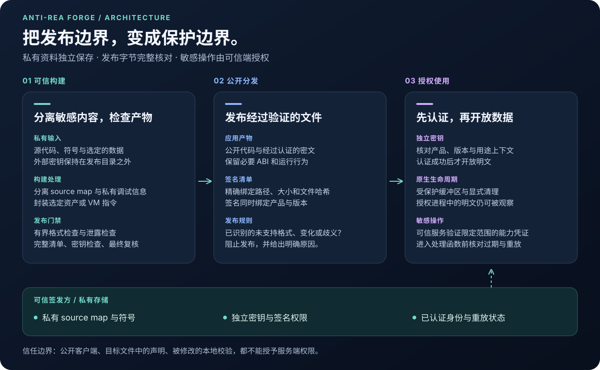

# Anti-REA Forge 1.0

[](https://github.com/Afloat16/anti-rea-forge/actions/workflows/ci.yml)
[](https://github.com/Afloat16/anti-rea-forge/releases/latest)
[](LICENSE)

[English](README.md) · [简体中文](README.zh-CN.md) · [下载 v1.0.0](https://github.com/Afloat16/anti-rea-forge/releases/tag/v1.0.0) · [升级说明](docs/releases/v1.0.0.md)

**减少逆向工具能从发布物中直接恢复的信息，把私有资料留在发布物之外。**

Anti-REA Forge 将有界发布检查、私有符号/source map 分离、原生数据认证加密与可信服务授权组合起来。Python、CMake/C++ 和 JavaScript 构建复用同一套发布决策，每项保护都配有可复现的正反对照。

| 大版本发布门禁 | 原生数据实验 | JavaScript 接入 |
| --- | --- | --- |
| **3 个操作系统 · 13 个必需 CI 作业** | **18,024 / 18,121 个候选中，精确恢复为 0** | **0 个 npm 运行时依赖** |
| Linux、Windows、macOS；独立安装 wheel、源码包和 SDK | 外部密钥样本；Ghidra 12.2 / IDA Freeware 5.0 历史配对对照 | Node.js 22+，隔离调用已安装的 Python 内核 |

上述候选数来自一个 32 字节 Linux i386 自有资源及指定提取流程，不是“所有工具破解失败率”。明文对照和故意泄露密钥的对照都能恢复资源。[实验数据](docs/results/native-asset-controls.json) · [发布门禁配置](release-policy.json) · [实时 CI](https://github.com/Afloat16/anti-rea-forge/actions/workflows/ci.yml)



## 1.0 的亮点

- **发现普通 strip 仍会留下的资料。** ELF 检查覆盖 CTF/BTF 私有类型信息；`split-elf-debug` 将符合条件的非分配元数据完整留在私有侧，从公开产物中移除，并核对运行段与导出 ABI。PE DWARF/STABS、thin/universal Mach-O 检查覆盖其他原生发布路径。
- **收紧打包和改名后的检查。** ZIP、packed ASAR 与已核对的 unpacked 旁文件共用检查预算；source map 按有界 JSON 内容、支持的编码和嵌套结构识别。已识别但未支持的容器、调试格式会明确阻止检查完成。
- **确保构建门禁调用真正的校验器。** CMake 与 JavaScript SDK 使用 Python 隔离模式，防止构建目录或 `PYTHONPATH` 同名模块替换校验。完整清单、密钥一致性与生成后的最终复核检测发布过程中的变化。
- **堵住原生封装的附加输出路径。** 核对完整函数和全局存储集合，拒绝可额外输出数据的 LLVM 元数据、附加常量及汇编。VM 指令封装仍为实验功能，明确限制支持的函数和目标平台。
- **在真正进入处理函数前核对授权。** 能力凭证在持久化消耗重放状态后再次检查有效期；存活中的重放存储对象拒绝数据库文件替换。共用文档读取器拒绝特殊文件、不安全叶子链接、超限及变化中的输入。
- **发布实际安装验证过的文件。** 发布流程要求 main 的全部指定 CI 作业成功，在三个系统的全新环境中安装 wheel 和源码包并测试打包 SDK；核对 SHA-256，再验证上传资产，最后公开 Release。

[核查、兼容性与证据](docs/releases/v1.0.0.md) · [便携发布接入](docs/portable-release.md) · [安全边界](SECURITY.md)

## 用实测数据说明效果

| 问题 | 实测结果 | 范围与证据 |
| --- | --- | --- |
| 直接嵌入的明文资源能被恢复吗？ | **能**，两款工具均成功 | [Ghidra/IDA 配对实验](docs/results/native-asset-controls.json)中的正对照 |
| 同一流程能恢复外部密钥加密的资源吗？ | **精确恢复 0 次**；逐一测试 Ghidra 的 18,024 个、IDA 的 18,121 个连续 32 字节候选 | 相同自有 i386 样本，分析器已初始化字节与原文件核对 |
| 不小心把真实密钥发出去会怎样？ | **密钥被提取并重放，原始资源成功恢复** | 两款工具均成功；生产发布检查也报告密钥泄露 |
| 修改本地 gate 能补上缺失的密钥吗？ | 明文对照可恢复；加密对照未恢复精确数据 | 真实 gate 补丁和强制 GCM 返回成功的对照，[方法](docs/native-assets.md) |
| 打开 1 MiB 原生资产的耗时？ | **中位数 189.860 微秒**；预热 5 次后测量 25 次；最大值 1,456.005 微秒 | 历史 v0.10、单台 Linux x86-64；含分配/清理，不含密钥交付和进程启动。[全部样本](docs/results/native-asset-cost.json) |
| 下载的 1.0 安装包验证了什么？ | 精确提交、必需 CI 作业、安装包行为和资产哈希 | [Release](https://github.com/Afloat16/anti-rea-forge/releases/tag/v1.0.0) 附带 `release-evidence.json`、`installation-report.json` 和 `SHA256SUMS` |

CI 实际执行 Ghidra、编译器、REA CLI/source map、官方 ASAR、GNU binutils、macOS 与 MSVC 对照。历史结果保留日期与失败记录：普通、混淆及仅 VM 的原生样本曾被独立重建，并匹配 **1,081,924 次隐藏求值**；这个失败推动了外部密钥指令封装。[原生代码研究与待验证边界](docs/native-code.zh-CN.md)

## 从发布门禁开始

需要 Python 3.10+。将 [v1.0.0](https://github.com/Afloat16/anti-rea-forge/releases/tag/v1.0.0) 的 wheel 安装进选定的虚拟环境，也可在仓库内运行 `python -m pip install .`。命令与 Python 导入名继续保持 `releaseguard`。

```sh
python -m pip install https://github.com/Afloat16/anti-rea-forge/releases/download/v1.0.0/open_release_guard-1.0.0-py3-none-any.whl
python -m releaseguard --version
python -m releaseguard project-init --root dist --product MyApp --out .releaseguard
python -m releaseguard check --config .releaseguard/project.json
```

把应用构建到 `dist`，审阅 `.releaseguard/policy.json`，将私有符号、密钥和签名材料保存在该目录之外。已知外部密钥可配置到项目的 `asset_key_files`。检查失败返回非零退出码；`prepare` 扫描并签名不可变的暂存目录，将证据写到发布目录外。[完整流程](docs/portable-release.md)

### JavaScript / TypeScript

```sh
npm install https://github.com/Afloat16/anti-rea-forge/releases/download/v1.0.0/anti-rea-forge-releaseguard-1.0.0.tgz
```

```js
import { createReleaseGuard } from "@anti-rea-forge/releaseguard";
const guard = createReleaseGuard({ python: process.env.RELEASEGUARD_PYTHON });
const report = await guard.checkProject({ config: ".releaseguard/project.json" });
process.exitCode = report.exitCode;
```

`RELEASEGUARD_PYTHON` 应指向已安装内核的虚拟环境解释器绝对路径。SDK 压缩包通过 GitHub Release 分发，不表示已发布到 npm registry。[SDK 指南](packages/releaseguard/README.zh-CN.md)

## 按保护目标选择接入方式

| 目标 | 接入 | 状态 |
| --- | --- | --- |
| 检测发布泄露与打包歧义 | [便携发布门禁](docs/portable-release.md) | 跨平台、由明确策略控制 |
| 没有外部密钥时保护选定的原生数据 | [原生资产](docs/native-assets.md) | C++17/OpenSSL，认证上下文绑定 |
| 不向客户端交付私有 source map 与调试/类型信息 | [Source map](docs/private-source-maps.md)、[ELF 符号](docs/private-elf-debug.md) | 受控输入的公开/私有分离 |
| 在可信代码中执行敏感操作 | [服务端能力凭证](docs/runtime-protection.zh-CN.md)、[分析网关](docs/analysis-authorization.md) | 需要已认证身份、固定策略与重放存储 |
| 加密选定的 VM 指令存储 | [原生代码](docs/native-code.zh-CN.md) | **实验性** LLVM 18 / Linux x86-64 标量整数子集 |

## 信任边界

发布扫描核对被检查字节是否满足配置规则，不会让 Ghidra、IDA、REA、Frida 或独立文件读取器失效。合法运行期间，进程可能持有密钥与明文；分发的代码和公开 helper 仍可观察；被修改的本地客户端不能决定服务端权限。发布目录、解释器、策略、密钥和重放状态必须可信。未知编码、未支持格式也不能被解释成通用防破解保证。

1.x 保持已有 v1 签名文档格式，以及 CLI/导入名。它尚未经过独立安全审计；实验性原生转换有明确范围。[安全政策](SECURITY.md) · [升级说明](docs/releases/v1.0.0.md) · [历史恢复失败记录](docs/testing-2026-10-15.zh-CN.md)

## 复现与贡献

```sh
python -m pip install -e .
python -m unittest discover -s tests -v
npm test --prefix packages/releaseguard
# 先设置 RELEASEGUARD_PYTHON 为已安装内核的解释器，再运行真实 CLI 集成：
npm run test:integration --prefix packages/releaseguard
```

CI 固定外部编译器/分析器输入，并将关键对照设为必需。缺失的本地工具会记为跳过，不算执行成功。欢迎提交附带小型自有样本和复现步骤的改进。[贡献指南](CONTRIBUTING.md) · [MIT 许可证](LICENSE)
